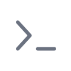
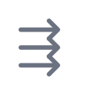
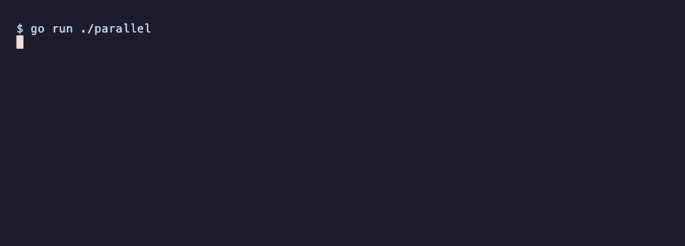
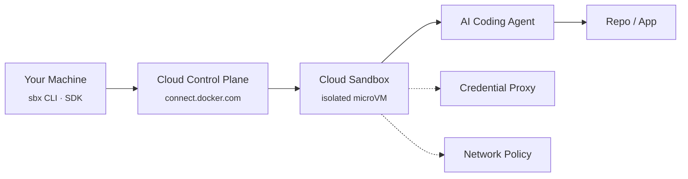

<div align="center">

# Docker Cloud Sandboxes Demos

### Your AI Agents. Their Own Cloud Sandboxes.

Explore, launch, and orchestrate AI coding agents in isolated **Docker Cloud Sandboxes**
through hands-on demos, CLI workflows, and SDK examples.

**[Quick start](#-quick-start)**&nbsp;·&nbsp;**[Demos](#-the-demos)**&nbsp;·&nbsp;**[Architecture](#-how-it-works)**&nbsp;·&nbsp;**[Go SDK](#-drive-it-from-code-go-sdk)**&nbsp;·&nbsp;**[Web portal](web)**

</div>

<table width="100%">
  <tr>
    <td align="center" width="220" height="128">
      <a href="agent-cli/claude"><br/><br/><b>Claude Code</b></a>
    </td>
    <td align="center" width="220" height="128">
      <a href="agent-cli/codex"><br/><br/><b>OpenAI Codex</b></a>
    </td>
    <td align="center" width="220" height="128">
      <a href="agent-cli/gemini"><br/><br/><b>Gemini CLI</b></a>
    </td>
    <td align="center" width="220" height="128">
      <a href="agent-cli/opencode"><br/><br/><b>OpenCode</b></a>
    </td>
  </tr>
  <tr>
    <td align="center" width="220" height="128">
      <a href="agent-cli/codex-dhi"><br/><br/><b>Codex + Docker DHI</b></a>
    </td>
    <td align="center" width="220" height="128">
      <a href="sdk/go/hello"><br/><br/><b>Go SDK · Hello</b></a>
    </td>
    <td align="center" width="220" height="128">
      <a href="sdk/go/parallel"><br/><br/><b>Go SDK · Parallel</b></a>
    </td>
    <td align="center" width="220" height="128">
      <a href="web"><br/><br/><b>Web Portal</b></a>
    </td>
  </tr>
</table>

Each tile links to a runnable demo. The agents use the `sbx` CLI; the SDK tiles are
programmatic Go. The **[Web Portal](web)** is a Next.js developer experience with an
interactive catalog and architecture diagram.

<div align="center">
  
  <br/><em><code>go run ./parallel</code> &mdash; five languages, five cloud microVMs, in parallel.</em>
</div>

## 🚀 Quick start

Prerequisite: the [`sbx`](https://docs.docker.com/ai/sandboxes/get-started/) CLI, signed in
with `sbx login`, and access to Docker Cloud Sandboxes (`sbx --cloud ls` should not error).

```bash
git clone https://github.com/ajeetraina/docker-cloud-sandboxes-demo.git
cd docker-cloud-sandboxes-demo/agent-cli/codex

./launch.sh                      # create a Codex cloud sandbox (micro, 4h TTL)
sbx --cloud attach codex-demo    # drop into the agent's terminal
./teardown.sh                    # delete it when you are done
```

> Cloud sandboxes bill while running (micro is about **$0.07/hr**) and auto-expire at
> their TTL. Always tear down when finished.

## 🧩 The demos

One folder per demo, each with `launch.sh`, `teardown.sh`, and a focused `README.md`.
They share one small library, [`lib/common.sh`](lib/common.sh), so each launcher stays short.

| Demo | Category | How you reach it | Status |
| --- | --- | --- | --- |
| [Claude Code](agent-cli/claude) | AI Coding Agent | `sbx --cloud attach` | scripted |
| [OpenAI Codex](agent-cli/codex) | AI Coding Agent | `sbx --cloud attach` | ✅ verified |
| [Gemini CLI](agent-cli/gemini) | AI Coding Agent | `sbx --cloud attach` | scripted |
| [OpenCode](agent-cli/opencode) | AI Coding Agent | `sbx --cloud attach` | scripted |
| [Codex + Docker DHI](agent-cli/codex-dhi) | Security & Governance | attach, then `/mcp` | ✅ verified |
| [Go SDK · Hello](sdk/go/hello) | Programmatic | program stdout | ✅ verified |
| [Go SDK · Parallel](sdk/go/parallel) | Programmatic | table + speedup | ✅ verified |

**Common options** (every `launch.sh`, see `-h`): `-n NAME`, `-t TTL`, `-s SIZE`
(`micro`…`xl`), `-e KEY=VALUE`. The `agent-cli` demos add `-r URL` (clone a repo),
`-k REF` (layer a kit), and `-A` (attach when ready).

## 🧠 How it works



- **Isolation** — each sandbox is a separate microVM; work inside cannot touch your host or another sandbox.
- **Credential proxy** — secrets are injected into outbound requests on the wire; the real value never enters the sandbox.
- **Network policy** — allow-all / balanced / deny-all presets plus per-sandbox rules control egress.
- **Lifecycle & TTL** — sandboxes auto-stop at their TTL (24h hard cap) and bill only while running.

Explore an interactive version in the **[Web Portal](web)** (click any component to learn its role).

## 🔐 Credentials: prefer secrets over env vars

The sandbox never sees the real value — the cloud proxy injects it into outbound requests to
the matching service. Store secrets **before** launching (a secret only reaches sandboxes
created afterwards):

```bash
sbx --cloud secret set anthropic --oauth          # Claude subscription (OAuth)
echo "$OPENAI_API_KEY" | sbx --cloud secret set openai
echo "$GEMINI_API_KEY" | sbx --cloud secret set google
sbx --cloud secret ls
```

## 🛡️ Security & governance demo

[`agent-cli/codex-dhi`](agent-cli/codex-dhi) is the flagship security demo: it launches Codex
with **Balanced** network egress plus `dhi.io`, wires the **Docker Hardened Images** MCP
server into Codex, and ships an `AGENTS.md` that steers the agent to prefer DHI for hardened
base images. It also shows proxy-injected `X-Docker-*` headers so a Docker PAT never enters
the sandbox.

## ⚡ Drive it from code (Go SDK)

The same cloud sandboxes can be driven programmatically with the
[Docker Sandboxes SDK](https://github.com/docker/sandboxes-api). [`sdk/go`](sdk/go) has
runnable Go examples, including a parallel fan-out that spins up several sandboxes at once.

```bash
cd sdk/go
export DOCKER_USERNAME=... DOCKER_PAT=...   # or DOCKER_ACCESS_TOKEN
go run ./hello       # one sandbox: create -> run -> delete
go run ./parallel    # N sandboxes at once, with a parallel-vs-sequential speedup
```

The SDK ships for TypeScript, Python, and Go; these examples use Go (`go get`), and the REST
API works for any language. See [`sdk/go/README.md`](sdk/go/README.md).

## 🖥️ Web portal

A Next.js + TypeScript + Tailwind developer experience lives in [`web/`](web): a hero,
interactive demo catalog with filters, and a clickable architecture diagram. Terminal
walkthroughs there are **simulated** and create no cloud resources.

```bash
cd web
npm install
npm run dev          # http://localhost:3000
```

## 🧹 Cleaning up

```bash
./teardown.sh                 # inside a demo folder (uses that demo's default name)
sbx --cloud ls                # list everything still running
sbx --cloud prune             # remove all stopped sandboxes
```

## 🔧 Troubleshooting

| Symptom | Fix |
| --- | --- |
| `sbx --cloud ls` errors | Run `sbx login`; confirm your account has Cloud Sandboxes access. |
| Agent "waiting for keys" | Store the provider secret **before** launch, then teardown + relaunch (secrets apply at create time). |
| A sandbox already exists | `./teardown.sh -n NAME`, or launch with a different `-n`. |
| Go SDK auth error | Use `DOCKER_USERNAME` + `DOCKER_PAT`, or a `DOCKER_ACCESS_TOKEN` JWT. |
| `git commit` hangs | This repo enables SSH commit signing; commit with `--no-gpg-sign` if the key prompt blocks. |

## 🤝 Contributing & security

See [CONTRIBUTING.md](CONTRIBUTING.md) to add a demo, and [SECURITY.md](SECURITY.md) to report
a vulnerability. This is a community playground for Docker Cloud Sandboxes, not an official
Docker product.

## ✅ Verified vs scripted

- **Verified** demos were run live end-to-end during development (create → use → teardown).
- **Scripted** demos are complete and validated (syntax / compile) but were not separately
  executed against the cloud. See each demo's README for details.
